<div align="center">

# SPMB SMK Ma'arif NU 1 Wangon

**Portal penerimaan murid baru: situs sekolah, pendaftaran tanpa akun, dan panel admin panitia dalam satu aplikasi.**

[](https://github.com/arnadd72/spmb-smk/actions/workflows/ci.yml)


[Situs langsung](https://spmbsmkmanusawa.sch.id) · [Dokumen kebutuhan (PRD)](docs/PRD.md) · [Panduan desain](docs/design/DESIGN.md) · [Aturan pengembangan](CLAUDE.md)

</div>

---

## Daftar isi

- [Tentang proyek](#tentang-proyek)
- [Tampilan](#tampilan)
- [Fitur](#fitur)
- [Alur pendaftaran](#alur-pendaftaran)
- [Teknologi](#teknologi)
- [Arsitektur](#arsitektur)
- [Memulai secara lokal](#memulai-secara-lokal)
- [Variabel lingkungan](#variabel-lingkungan)
- [Perintah](#perintah)
- [Pengujian](#pengujian)
- [Peran admin](#peran-admin)
- [Deploy](#deploy)
- [Keamanan dan privasi](#keamanan-dan-privasi)
- [Dokumentasi](#dokumentasi)
- [Cara berkontribusi](#cara-berkontribusi)

## Tentang proyek

Sistem Penerimaan Murid Baru (SPMB) untuk **SMK Ma'arif NU 1 Wangon**, Banyumas, Jawa Tengah. Seluruh proses
dilakukan daring: calon murid mengenal sekolah, mencoba tes minat bakat, mendaftar, dan mengecek status tanpa membuat akun,
sementara panitia memverifikasi berkas dan mengelola data dari satu panel admin.

Satu aplikasi **Next.js full-stack**. Tidak ada server terpisah, Docker, atau layanan OCR berbayar. Aplikasi sudah dipakai
pendaftar sungguhan di produksi.

Program keahlian: **AKL** (Akuntansi dan Keuangan Lembaga), **MPLB** (Manajemen Perkantoran dan Layanan Bisnis),
**LPK3** (Layanan Penunjang Kefarmasian Klinis dan Komunitas), dan **TKR** (Teknik Kendaraan Ringan).

## Tampilan

Desain bernuansa hijau NU dan kuning kunyit, dengan tipografi Poppins. Halaman dirancang mobile-first dan diperiksa aksesibilitasnya secara otomatis (axe, WCAG 2.1 AA) di tes e2e.

<div align="center">

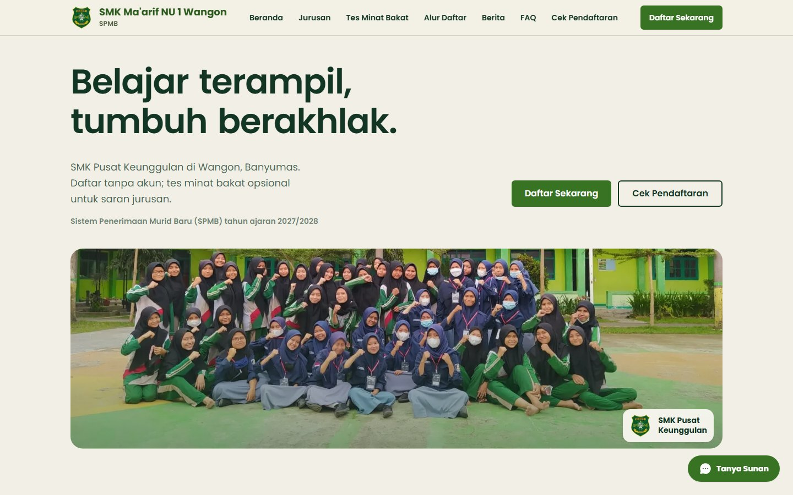

<sub><b>Beranda</b>: tombol daftar dan cek pendaftaran langsung terlihat, tanpa perlu membuat akun.</sub>

</div>

<br>

<table>
  <tr>
    <td width="50%" valign="top">
      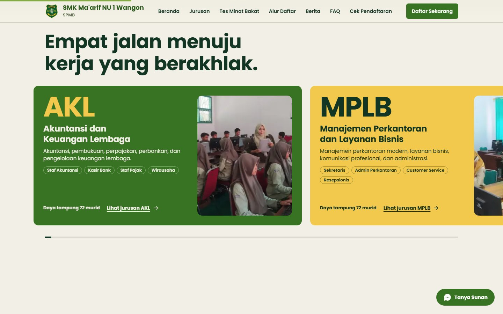
      <br><sub><b>Program keahlian</b> di beranda: gulir vertikal menggeser kartu ke samping.</sub>
    </td>
    <td width="50%" valign="top">
      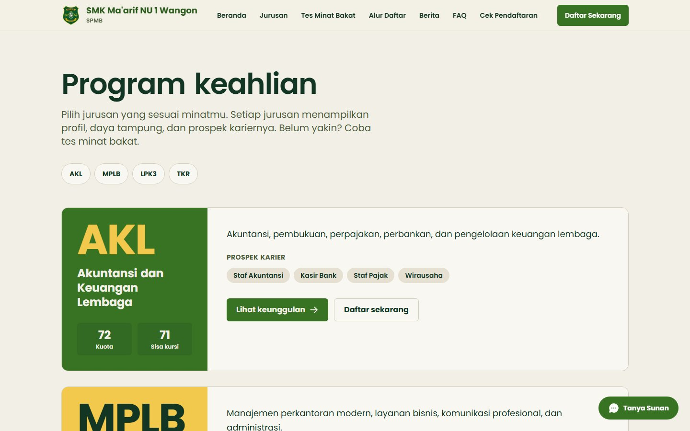
      <br><sub><b>Halaman jurusan</b>: profil, daya tampung, dan prospek karier tiap jurusan.</sub>
    </td>
  </tr>
  <tr>
    <td width="50%" valign="top">
      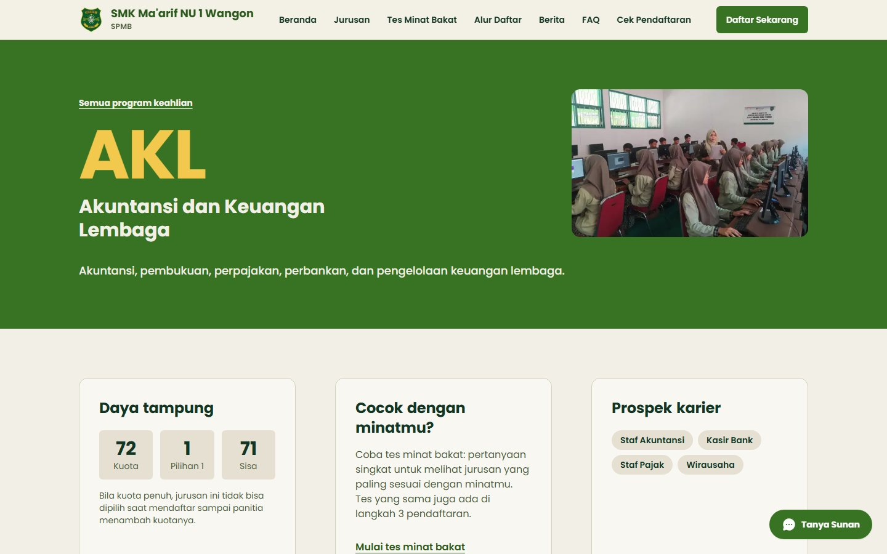
      <br><sub><b>Detail jurusan</b>: foto, deskripsi, daya tampung, dan prospek karier.</sub>
    </td>
    <td width="50%" valign="top">
      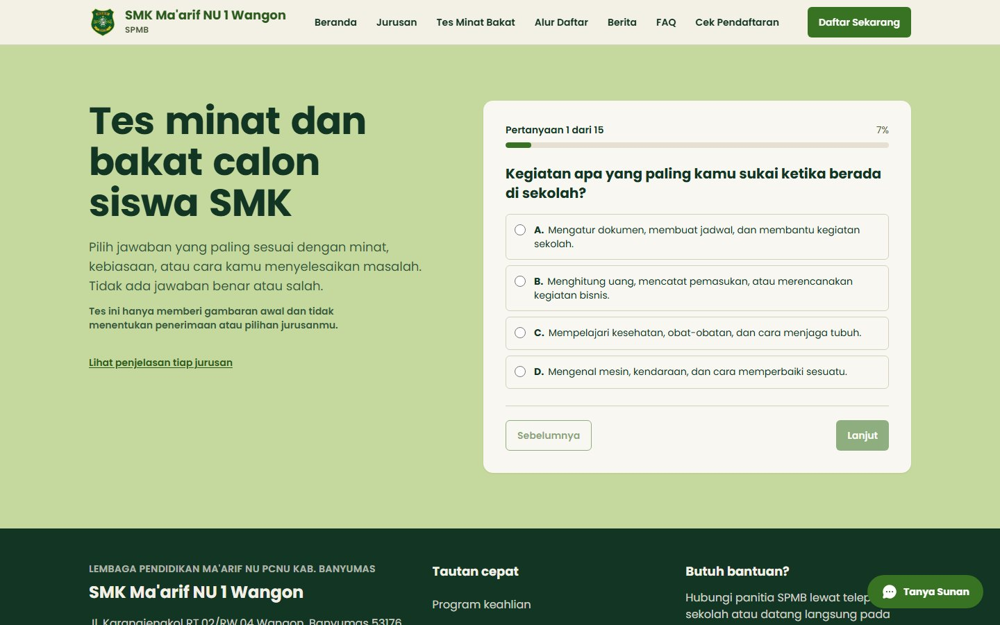
      <br><sub><b>Tes minat bakat</b>: saran jurusan dari jawaban pendaftar.</sub>
    </td>
  </tr>
</table>

<br>

<div align="center">

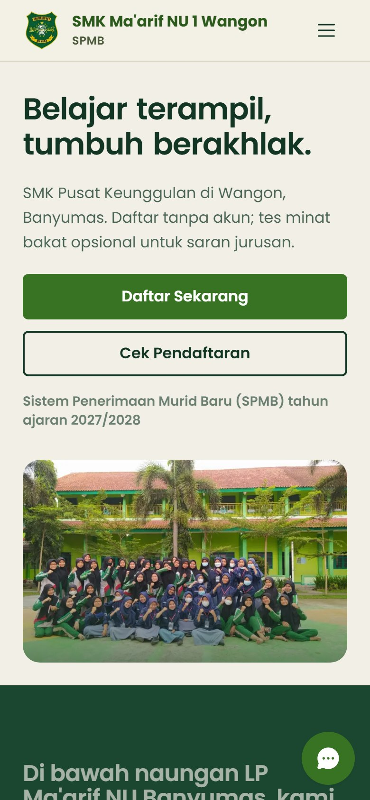
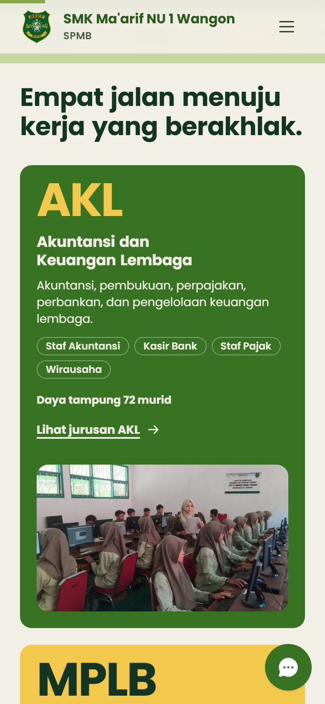
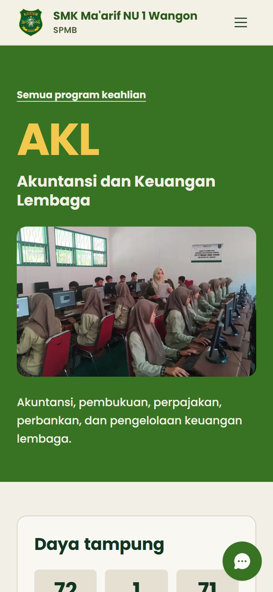

<sub><b>Di HP</b>: beranda, program keahlian, dan detail jurusan.</sub>

<br><br>

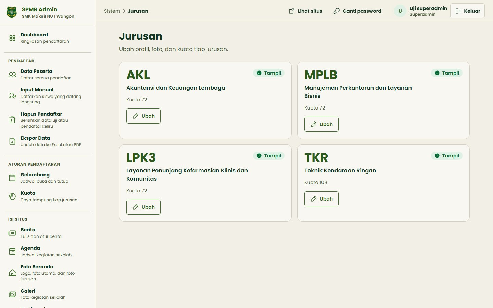

<sub><b>Panel admin</b>: menu terkelompok per tugas (pendaftar, aturan pendaftaran, isi situs, sistem). Tampilan di atas dari lingkungan pengembangan dengan data contoh.</sub>

</div>

## Fitur

### Untuk calon murid dan orang tua

| Fitur | Penjelasan |
|---|---|
| **Situs sekolah** | Profil, program keahlian (deskripsi, keunggulan, prospek karier, daya tampung), berita, agenda, galeri, testimoni, FAQ. |
| **Pendaftaran 8 langkah tanpa login** | Mengikuti formulir kertas resmi. Draf tersimpan otomatis sehingga bisa dilanjutkan dari perangkat yang sama. |
| **OCR di browser** | Akta kelahiran dan Kartu Keluarga dibaca langsung di HP pendaftar dengan PaddleOCR (WebAssembly). Foto dokumen tidak dikirim ke layanan OCR luar dan tanpa biaya per pembacaan. |
| **Tes minat bakat** | Soal dari sekolah (dikelola admin) untuk saran jurusan. Bisa dipakai sebagai halaman publik atau sebagai langkah opsional di wizard. |
| **Tanya Sunan** | Asisten tanya jawab yang menjawab hanya dari informasi resmi sekolah (memakai Gemini, dengan pemeriksa jawaban dan FAQ sebagai cadangan). |
| **PDF formulir** | Formulir pendaftaran digambar langsung dari kode, siap dicetak, memuat nomor pendaftaran, pas foto, dan tanda terima. |
| **Cek status dan edit formulir** | Pendaftar memantau status lewat kode pendaftaran dan memperbaiki isian selama masih diizinkan. |

### Untuk panitia

| Fitur | Penjelasan |
|---|---|
| **Dashboard dan statistik** | Ringkasan pendaftar, kuota per jurusan, dan kinerja OCR. |
| **Verifikasi berkas dan nilai** | Dokumen dilihat lewat penampil terproteksi, setiap pembukaan tercatat di log audit. |
| **Data pendaftar** | Pencarian, penyuntingan, input manual, dan penghapusan terkontrol. |
| **Kuota dan gelombang** | Daya tampung per jurusan dan jadwal gelombang pendaftaran. |
| **Pengelola konten** | Berita, agenda, galeri, foto beranda, testimoni, FAQ, soal tes minat, dan profil jurusan (deskripsi, keunggulan, prospek karier, kuota). Teks panjang tersimpan utuh dan galat batas karakter menyebut bagian serta barisnya. |
| **Form builder** | Isian formulir bisa ditambah atau disesuaikan tanpa mengubah kode. |
| **Ekspor dan rekap** | Ekspor data ke Excel (XLSX) dan rekap PDF. |
| **Email dan tugas harian** | Email kode pendaftaran lewat Resend. Tugas harian: bersihkan draf kedaluwarsa, ulangi unggah Drive yang gagal, kirim ulang email tertunda. |

## Alur pendaftaran

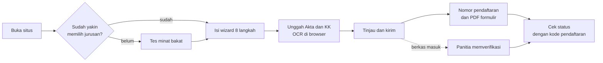

## Teknologi

| Lapisan | Teknologi |
|---|---|
| Framework | Next.js 16 (App Router, Server Components), React 19, TypeScript |
| Tampilan | Tailwind CSS 4, Radix UI, Phosphor Icons, Motion, GSAP + Lenis |
| Form dan validasi | React Hook Form + **Zod** (satu skema dipakai klien dan server) |
| Database | PostgreSQL lewat **Prisma 7** (Supabase di produksi, Postgres lokal untuk pengembangan) |
| Autentikasi admin | Sesi JWT (`jose`) di cookie httpOnly, kata sandi `bcryptjs` |
| OCR | PaddleOCR (`ppu-paddle-ocr` + `onnxruntime-web`, WASM) di Web Worker |
| Penyimpanan dokumen | Google Drive API (privat, tanpa URL publik) dan Supabase Storage untuk berkas sementara dan konten publik |
| Email | Resend |
| Dokumen keluaran | `pdf-lib` (PDF), `exceljs` (XLSX), `sharp` (olah gambar) |
| Asisten tanya jawab | Gemini API |
| Pengujian | Vitest + Testing Library, Playwright + axe-core |
| Kualitas | ESLint, Prettier, TypeScript mode ketat |

## Arsitektur

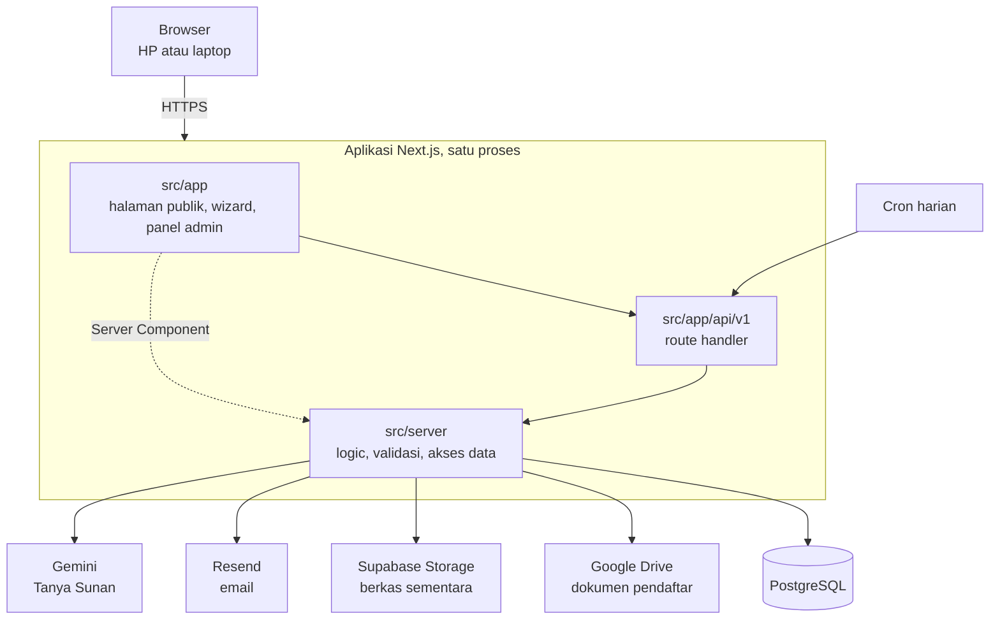

Prinsip yang dijaga:

- **Satu jalur, satu arah:** UI → route handler → `src/server`. Hanya `src/server` yang berbicara ke Prisma, Google Drive, Supabase, dan Resend.
- **Satu skema Zod per entitas** di `src/server/validasi/`, otoritatif di server dan dipakai form klien.
- **OCR berjalan di browser**, bukan di server.
- **Dokumen pendaftar tidak pernah punya URL publik.** Dilihat lewat route admin yang mencatat audit.

<details>
<summary><b>Struktur folder</b></summary>

```text
src/
├── app/                  # tampilan dan route API
│   ├── (publik)/         #   beranda, jurusan, berita, tes minat bakat, cek status
│   ├── (daftar)/         #   wizard pendaftaran dan halaman sukses
│   ├── (admin)/          #   panel admin
│   └── api/v1/           #   route handler (admin, draf, pendaftar, cron, tanya, ...)
├── server/               # SEMUA logic backend
│   ├── actions/          #   aksi baca dan tulis per fitur
│   ├── auth/             #   sesi, peran, CSRF
│   ├── db/               #   klien Prisma
│   ├── services/         #   kripto, PDF formulir, Drive, Tanya Sunan, dll.
│   └── validasi/         #   skema Zod (juga dipakai klien lewat schema-client.ts)
├── features/             # komponen per fitur (landing, wizard, admin, jurusan, ...)
├── components/           # komponen dasar (ui) dan animasi
├── lib/                  # util klien, termasuk mesin OCR (lib/ocr)
└── styles/
prisma/                   # skema, migrasi, seed
scripts/                  # Postgres lokal, cadangan dan pemulihan, setup tes
tests/                    # unit, komponen, e2e
docs/                     # PRD, panduan desain, template formulir, arsip
```

Aturan lapisan lengkap ada di [`CLAUDE.md`](CLAUDE.md).

</details>

## Memulai secara lokal

**Prasyarat:** Node.js 22 dan PostgreSQL 14 atau lebih baru. Docker tidak wajib: proyek menyediakan Postgres lokal tanpa Docker.

```bash
git clone https://github.com/arnadd72/spmb-smk.git
cd spmb-smk

npm install                  # sekaligus menjalankan prisma generate
cp .env.example .env         # lalu isi variabel wajib (lihat bagian berikut)

npm run db:start             # Postgres lokal di port 5433, tanpa Docker
npm run db:migrate           # terapkan migrasi
npm run db:seed              # data awal dan akun superadmin dari ADMIN_SEED_*
npm run dev                  # http://localhost:3000
```

Bangkitkan rahasia (jangan pernah commit hasilnya):

```bash
node -e "const c=require('crypto');console.log('JWT_SECRET='+c.randomBytes(48).toString('base64url'));console.log('ENCRYPTION_KEY='+c.randomBytes(32).toString('hex'))"
```

Halaman yang berguna: `/` (beranda), `/jurusan`, `/tes-minat-bakat`, `/daftar`, `/admin/login`, dan `/admin/_katalog`
(katalog komponen, hanya lokal).

> **Peringatan database.** Periksa `DATABASE_URL` dan `DIRECT_URL` di `.env` sebelum menjalankan perintah Prisma apa pun.
> Bila mengarah ke database bersama (mis. Supabase), **jangan** jalankan `db:migrate` atau `db:seed`: riwayat migrasi yang tidak cocok
> bisa memicu tawaran reset yang menghapus seluruh data. Ke database bersama hanya `npx prisma migrate deploy`.

## Variabel lingkungan

Semua variabel ada di [`.env.example`](.env.example). Tanpa kredensial layanan luar, fitur terkait menjawab galat yang jelas dan sisanya tetap berjalan.

| Kelompok | Variabel | Fungsi |
|---|---|---|
| Aplikasi | `NEXT_PUBLIC_SITE_URL`, `NEXT_PUBLIC_API_BASE`, `APP_TIMEZONE` | Alamat situs dan zona waktu |
| Database | `DATABASE_URL`, `DIRECT_URL` | Koneksi query dan koneksi migrasi |
| Autentikasi | `JWT_SECRET` (min. 32 karakter), `ENCRYPTION_KEY` (64 hex), `ADMIN_SEED_USERNAME`, `ADMIN_SEED_PASSWORD` | Sesi admin, enkripsi data sensitif, akun awal |
| Google Drive | `GOOGLE_DRIVE_CLIENT_ID`, `GOOGLE_DRIVE_CLIENT_SECRET`, `GOOGLE_DRIVE_REDIRECT_URI`, `GOOGLE_DRIVE_ROOT_FOLDER_NAME` | Penyimpanan dokumen pendaftar |
| Supabase | `NEXT_PUBLIC_SUPABASE_URL`, `NEXT_PUBLIC_SUPABASE_ANON_KEY`, `SUPABASE_SERVICE_ROLE_KEY`, `SUPABASE_BUCKET_*` | Berkas sementara dan konten publik |
| Gemini | `GEMINI_API_KEY`, `GEMINI_MODEL`, `GEMINI_BATAS_HARIAN` | Tanya Sunan dan batas pemanggilan harian |
| Email | `RESEND_API_KEY`, `RESEND_FROM` | Email kode pendaftaran |
| Cron | `CRON_SECRET` (min. 16 karakter) | Mengamankan endpoint tugas terjadwal |
| Lain-lain | `WA_GROUP_URL`, `DRAF_TEMP_DIR` | Tautan grup WhatsApp, folder draf sementara saat dev |

> **Rahasia tidak pernah ditulis ke berkas yang di-commit.** Pakai `.env` lokal dan perbarui `.env.example` setiap menambah variabel.

## Perintah

| Perintah | Fungsi |
|---|---|
| `npm run dev` | Server pengembangan di `http://localhost:3000` |
| `npm run build` / `npm start` | Build dan jalankan produksi |
| `npm run lint` / `npm run typecheck` | ESLint / TypeScript |
| `npm test` | Tes unit dan komponen (Vitest) |
| `npm run test:e2e` | Tes end-to-end (Playwright, termasuk pemeriksaan aksesibilitas axe) |
| `npm run db:start` / `db:stop` / `db:status` | Kelola Postgres lokal |
| `npm run db:migrate` | `prisma migrate dev` (hanya ke database lokal) |
| `npm run db:deploy` | `prisma migrate deploy` (aman untuk database bersama) |
| `npm run db:seed` | Isi data awal (hanya ke database lokal) |
| `npm run db:backup` / `db:pulihkan` | Cadangkan dan pulihkan database lewat skrip Node |

## Pengujian

- **Tes unit dan komponen** (`npm test`) memakai database lokal `spmb_test`, yang dikosongkan tiap berkas uji. Postgres lokal harus menyala.
- **Tes e2e** (`npm run test:e2e`) memakai database lokal terpisah `spmb_e2e_test` dan server sendiri di port 3100 (konfigurasi `.env.test`, tidak di-commit).
  Playwright menolak berjalan bila `DATABASE_URL` bukan Postgres lokal berakhiran `_test`, jadi aman dijalankan bersamaan dengan `npm run dev`.
- Setup pertama kali: `npm run db:start` lalu `npm run db:test:siapkan`. Contoh isi `.env.test` ada di `.env.example`.
- **CI** (GitHub Actions) menjalankan lint, typecheck, tes, dan build pada setiap push ke `main` dan pull request.
- Setiap fitur wajib punya tes, dan tes harus hijau sebelum pekerjaan dinyatakan selesai.

## Peran admin

| Peran | Cakupan |
|---|---|
| **superadmin** | Semua fitur, termasuk yang khusus peran ini: profil jurusan, form builder, pengaturan (termasuk Google Drive), akun admin, log audit, dan penghapusan pendaftar. |
| **panitia** | Pendaftar: verifikasi, data peserta, input manual, kuota, gelombang, ekspor. Boleh melihat data jurusan tanpa mengubahnya. |
| **konten** | Konten publik: berita, agenda, galeri, foto beranda, testimoni, FAQ, dan soal tes minat bakat. |

## Deploy

Situs produksi berjalan di **hosting cPanel (Node.js)**. **Vercel** menjadi cadangan sekaligus penjalan cron harian.

| | Produksi | Cadangan |
|---|---|---|
| Hosting | cPanel Node.js, domain `spmbsmkmanusawa.sch.id` | Vercel |
| Cara rilis | Workflow GitHub **Rilis hosting** (manual) menghasilkan paket `spmb-rilis`, lalu diunggah ke cPanel | Otomatis setiap push ke `main` |
| Database | Supabase PostgreSQL | Supabase PostgreSQL yang sama |

Catatan rilis:

- Workflow **Rilis hosting** membangun aplikasi dalam mode `standalone` memakai database sementara di runner GitHub, jadi **tidak menyentuh database produksi**.
- Migrasi ke database produksi hanya lewat `npx prisma migrate deploy`, setelah berkas migrasinya di-push dan pemilik proyek setuju.
- Nilai `NEXT_PUBLIC_*` tertanam saat build. Bila domain berubah, jalankan ulang workflow dengan variabel GitHub yang baru.
- Tugas harian (hapus draf kedaluwarsa, bersihkan catatan pembatas laju, ulangi unggah Drive yang gagal, kirim ulang email tertunda) dijalankan Vercel Cron lewat `/api/v1/cron/harian`.
- Cadangan database: `npm run db:backup` (hasilnya memuat data pribadi, simpan di luar repo dan simpan `ENCRYPTION_KEY` secara terpisah).

## Keamanan dan privasi

- **Siswa tidak login.** Akses draf dan status memakai token acak; yang disimpan hanya hash SHA-256 di cookie httpOnly.
- **Data sensitif** (NIK, nomor KK, nomor HP) dienkripsi AES-256-GCM sebelum masuk database.
- **Dokumen pendaftar** disimpan di Google Drive privat tanpa URL publik; setiap pembukaan oleh admin tercatat di log audit.
- **Admin:** sesi JWT di cookie httpOnly, kata sandi di-hash `bcryptjs`, percobaan login dibatasi, dan perubahan data dilindungi pemeriksaan `Origin` (CSRF).
- **Header keamanan** (CSP, HSTS, `X-Frame-Options`, `Referrer-Policy`) diatur lewat `next.config.ts`; HTML berita disanitasi di server.
- **Row Level Security** aktif di database.

## Dokumentasi

| Dokumen | Isi |
|---|---|
| [`docs/PRD.md`](docs/PRD.md) | **Sumber kebenaran** produk: tujuan, arsitektur, skema, fitur, keputusan, roadmap |
| [`docs/design/DESIGN.md`](docs/design/DESIGN.md) | Panduan desain: warna, tipografi, komposisi, motion |
| [`docs/template-formulir.md`](docs/template-formulir.md) | Isi dan urutan isian formulir pendaftaran |
| [`docs/arsip/PRD-v3.1.md`](docs/arsip/PRD-v3.1.md) | PRD versi sebelumnya (dirujuk oleh PRD v4) |
| [`docs/catatan-revisi.md`](docs/catatan-revisi.md) | Catatan revisi |
| [`CLAUDE.md`](CLAUDE.md) dan [`AGENTS.md`](AGENTS.md) | Aturan lapisan dan cara kerja agen AI di repo ini |

Kerja lama (Laravel, OCR Python, Docker) ada di `_archive/` hanya sebagai acuan konsep dan tidak dipakai.

## Cara berkontribusi

1. Baca [`docs/PRD.md`](docs/PRD.md) sebelum mengerjakan apa pun.
2. Jangan menambah fitur, library, atau mengubah arsitektur di luar PRD tanpa bertanya. Keputusan baru dicatat di PRD, **di commit yang sama** dengan kodenya.
3. Kerjakan satu milestone per commit. Pesan commit menyebut milestone dan alasannya (konvensi: `feat(area): ...`, `fix(area): ...`).
4. Pastikan `npm run lint`, `npm run typecheck`, dan `npm test` hijau sebelum commit.
5. Bahasa antarmuka adalah **Bahasa Indonesia**.

---

<div align="center">

Dibuat untuk **SMK Ma'arif NU 1 Wangon** · Wangon, Banyumas, Jawa Tengah

</div>
